# Nano Drone

A palm-sized quadcopter built from scratch around an **Arduino Nano 33 BLE**: 3D-printed frame, hand-soldered mainboard, MOSFET PWM motor drivers, MPU6050 attitude sensing, a PID stabilisation loop, and phone control over **Bluetooth Low Energy** through a custom MIT App Inventor app.

Final project for **EE174 – Analog Peripherals for Embedded Systems**, San José State University (Spring 2022), built by **Harkiret Singh** and **Sébastien Trocherie**, supervised by Prof. Tan Nguyen.

<p align="center">
  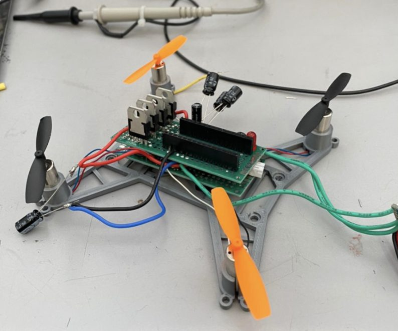
  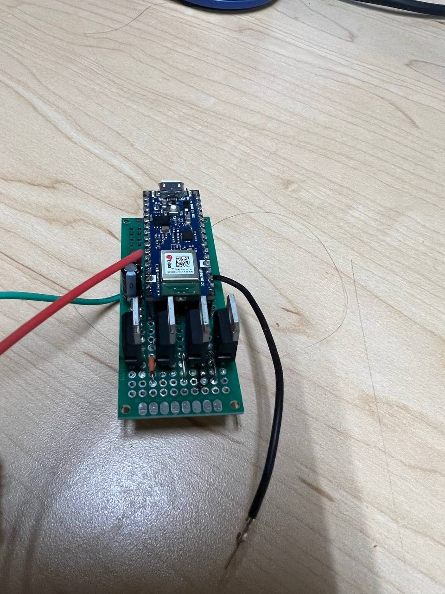
</p>

---

## At a glance

| | |
|---|---|
| **Controller** | Arduino Nano 33 BLE (nRF52840, built-in BLE radio) |
| **IMU** | MPU6050 (3-axis gyro + 3-axis accelerometer, on-chip DMP) over I²C |
| **Motors** | 4 × 8520 brushed DC coreless motors (8.5 mm × 20 mm, ≈2.75 A each at full load) |
| **Motor drivers** | 4 × low-side logic-level N-MOSFETs switched by hardware PWM |
| **Power** | 1S LiPo, 3.7 V nominal / 4.2 V full, 650 mAh |
| **Protection** | P-MOSFET (AO3401A) reverse-polarity protection, bulk + decoupling capacitors, flyback diodes |
| **Frame** | 3D-printed PLA, ~111 × 114 mm, Prusa i3 MK3S |
| **Control link** | BLE GATT, custom 128-bit service, MIT App Inventor Android app |
| **Cost** | $184.66 total ([BOM](#bill-of-materials)) |

## What works and what doesn't

This was a proof-of-concept, and it did not reach stable flight by the end of the semester. Here's where each subsystem ended up:

| Subsystem | Status | Evidence |
|---|---|---|
| Frame design + printing | ✅ Done | [hardware/frame](hardware/frame), photos below |
| Mainboard (power, MOSFET drivers, protection) | ✅ Built and powered from battery | [docs/hardware.md](docs/hardware.md) |
| PWM motor speed control | ✅ Working on all four motors | [`pwm_motor_ramp`](firmware/pwm_motor_ramp) |
| BLE phone → Arduino control | ✅ Working with the custom app | [`ble_gesture_control`](firmware/ble_gesture_control), [docs/firmware.md](docs/firmware.md#ble-control) |
| MPU6050 + PID stabilisation | ⚠️ Shown on a breadboard rig with LEDs standing in for motors | [`flight_controller_nano33ble`](firmware/flight_controller_nano33ble) |
| Full integration / sustained flight | ❌ Not reached: the battery sagged below the MCU's brown-out voltage under motor load | [Problems encountered](#problems-encountered--lessons-learned) |

## System overview

```
        Phone (MIT App Inventor app)
                   │  BLE (custom GATT service)
                   ▼
 ┌───────────────────────────────────┐   I²C    ┌─────────────┐
 │        Arduino Nano 33 BLE        │◄────────►│   MPU6050   │
 │                                   │          │  (DMP: yaw/ │
 │  DMP quaternion → yaw/pitch/roll  │          │ pitch/roll) │
 │  pitch PID ─┐                     │          └─────────────┘
 │  roll  PID ─┴─► motor mixer       │
 │  battery ADC (A0, filtered)       │
 └──┬──────┬──────┬──────┬───────────┘
   D3     D9    D10    D11      PWM
    ▼      ▼      ▼      ▼
  N-FET  N-FET  N-FET  N-FET   (low-side switches)
    │      │      │      │
   M_FL   M_FR   M_BR   M_BL    8520 brushed motors ← VMOT ← P-FET ← 1S LiPo
```

### Control loop

Each iteration the flight controller:

1. Reads a DMP packet from the MPU6050 FIFO and turns it into yaw / pitch / roll (degrees).
2. Subtracts a level-attitude calibration captured while throttle = 0.
3. Runs two PID controllers (pitch and roll, setpoint 0°, Kp = 0.5, Ki = 0.05, Kd = 0.05, output clamped to ±20).
4. Mixes the PID outputs into four motor commands:

   ```
   FL = throttle + roll − pitch
   FR = throttle + roll + pitch
   BR = throttle − roll + pitch
   BL = throttle − roll − pitch      (each clamped at ≥ 0)
   ```
5. Low-pass filters the battery reading (`v = 0.9·v + 0.1·new`) and warns below 2.0 V.

More detail is in [docs/firmware.md](docs/firmware.md).

## Repository layout

```
Nano_Drone/
├── firmware/
│   ├── flight_controller_nano33ble/   Integrated build: MPU6050 DMP + PID + mixer + PWM + battery monitor
│   ├── flight_controller_nano_avr/    Earlier version for a classic ATmega328 Nano + serial BT module
│   ├── ble_gesture_control/           BLE peripheral driven by the phone app (custom GATT service)
│   ├── ble_peripheral_led/            BLE peripheral bring-up, blinks LED on command
│   ├── ble_advertise_test/            Minimal "is the BLE radio alive" advertising test
│   ├── ble_serial_echo/               Serial echo + advertising test
│   └── pwm_motor_ramp/                Ramps a motor through 0–255 PWM duty to test the drivers
├── hardware/
│   ├── frame/                         STL / 3MF / G-code for the printed frame
│   └── README.md                      Wiring, pin map, component choices
├── docs/
│   ├── hardware.md                    Power, motor, MOSFET and battery design calculations
│   ├── firmware.md                    BLE GATT design, PID loop, battery measurement
│   ├── reports/                       Final report, proposal, slides, handwritten design notes (PDF)
│   └── images/                        Photos, schematics, app screenshots
└── README.md
```

## Hardware

<p align="center">
  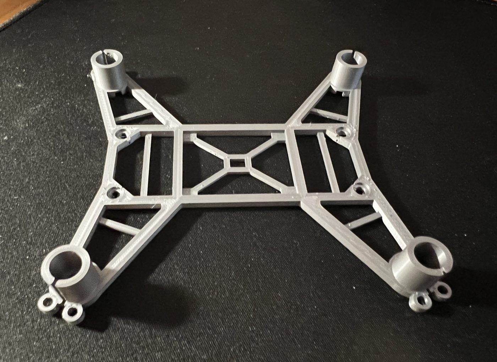
  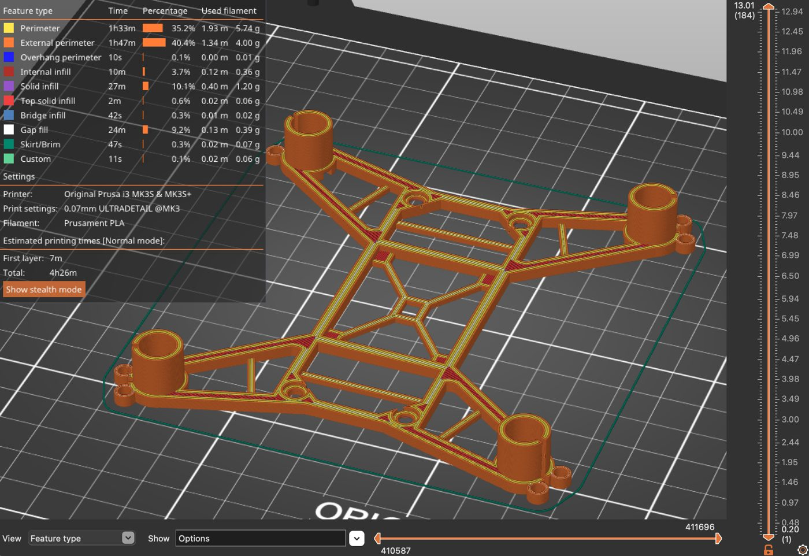
</p>

* **Frame:** kept as small and light as possible, with motor sockets sized for 8520 motors. Printed in PLA at 0.07 mm layers (≈4 h 26 min, ≈12 g of filament).
* **Motor drive:** each motor's + lead goes straight to the switched battery rail and its – lead goes to a low-side N-MOSFET. PWM on the gate sets the average motor voltage. The MOSFETs were picked for a low V<sub>GS(th)</sub> (≈1 V, so 3.3 V logic fully enhances them), I<sub>D</sub> ≥ 3 A, and R<sub>DS(on)</sub> in the tens of mΩ (0.3 Ω would waste ≈0.9 V at 3 A).
* **Reverse-polarity protection:** a P-MOSFET (AO3401A) in the supply path instead of a series diode, so a correctly inserted battery loses only I·R<sub>DS(on)</sub> rather than a diode drop.
* **Battery sizing:** 4 motors × 2.75 A ≈ 11 A peak. A 650 mAh pack needs ≥ 11 A / 0.65 Ah ≈ 17 C, and full-throttle endurance works out to ≈ 0.65 Ah × 60 / 11 A ≈ 3.5 min.

Full design notes: **[docs/hardware.md](docs/hardware.md)** · Wiring and pin map: **[hardware/README.md](hardware/README.md)**

<p align="center">
  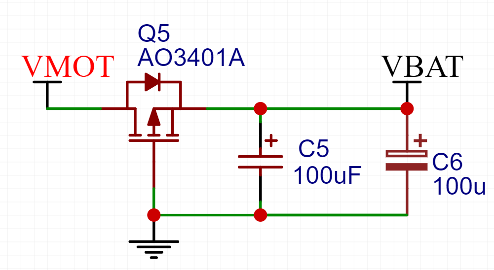
  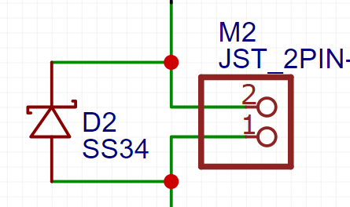
</p>

## BLE phone control

The Nano 33 BLE runs as a BLE **peripheral** named `drone` and exposes one custom 128-bit service with a read/write byte characteristic:

| | UUID |
|---|---|
| Service | `faa94135-6303-4274-a2ce-8fa28849ac9c` |
| Characteristic (read / write) | `a6671089-7187-4a45-adee-6020212f014d` |

A small Android app built in **MIT App Inventor** scans for the device, connects, and writes values to the characteristic. The Arduino reacts on `characteristic.written()`.

<p align="center">
  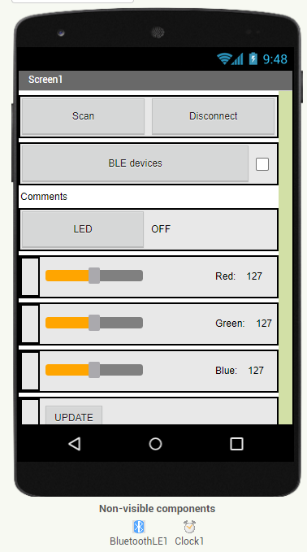
  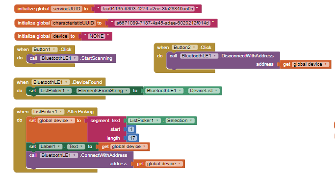
</p>

## PID / gyro demo rig

The MPU6050 couldn't be run reliably on the drone itself (the Nano's supply rail sagged under motor load), so the attitude + PID pipeline was shown on a breadboard rig. Four LEDs stand in for the motors, and each LED brightens as the board tilts toward its side, i.e. the correction that motor would apply.

<p align="center">
  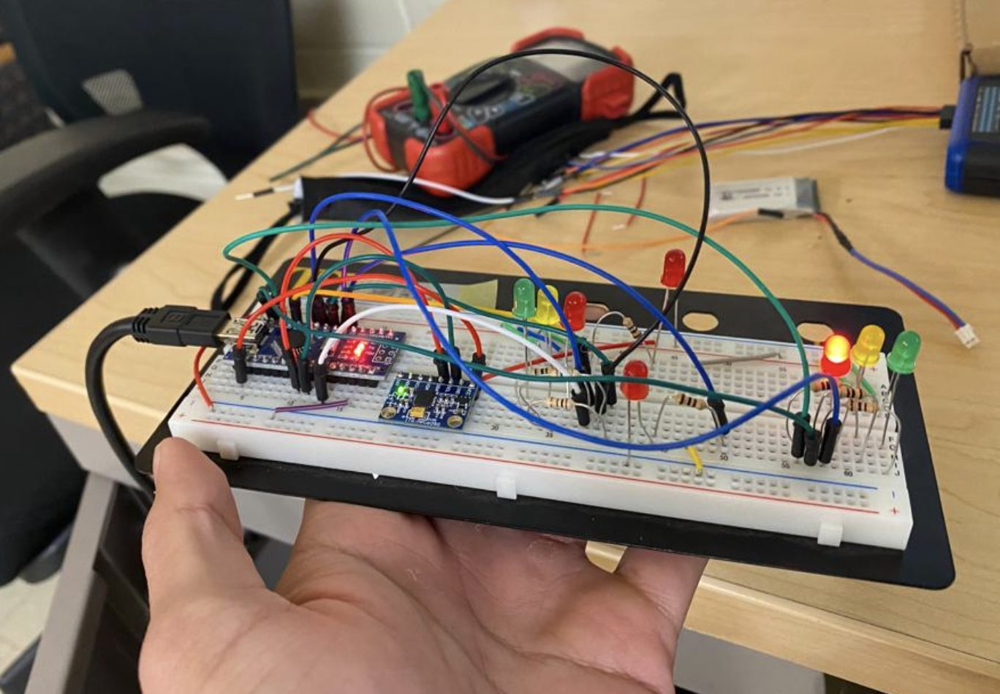
  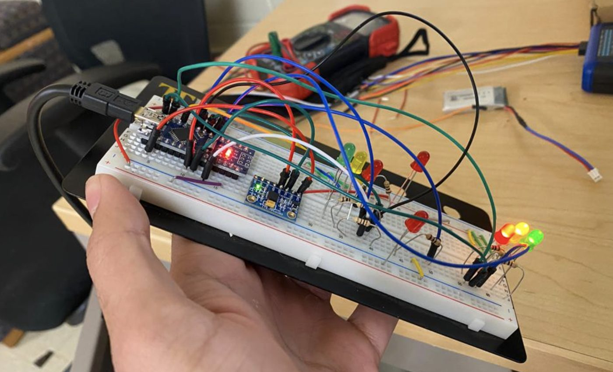
</p>

## Problems encountered & lessons learned

<p align="center">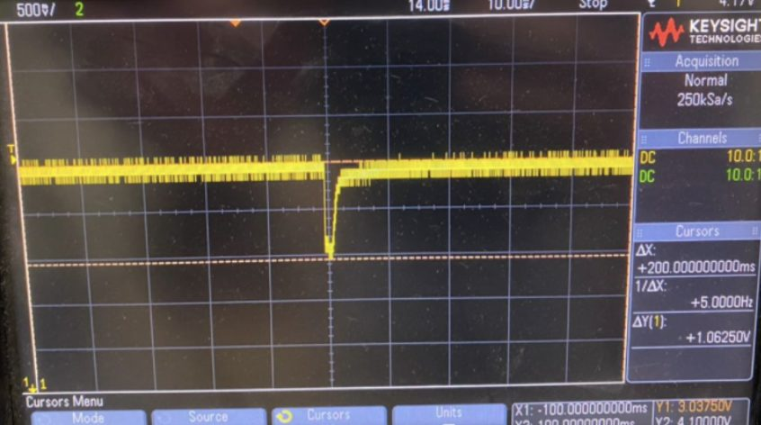</p>

* **Battery sag → brown-out resets.** With all four motors drawing ≈2.8 A each (≈11 A total), the drop across the LiPo's internal resistance pulled the rail down to ≈1.8–1.9 V (scope capture above). The Nano 33 BLE's brown-out threshold is ≈2.6 V, so the board reset whenever the motors spun up. Next time I'd use a higher-C, lower-ESR pack, add a boost/LDO stage or a separate supply for the logic, add more bulk capacitance near the MCU, and soft-start the motors.
* **IMU on the airframe.** For the same reason the MPU6050 never ran reliably on the drone itself, so stabilisation was only shown on the bench rig.
* **Integration gaps in the firmware** (honest notes for anyone picking this up):
  * In `flight_controller_nano33ble`, the final `runIndividual(actSpeed)` call is commented out, so PID corrections are computed and printed but not yet applied to the motors. Only the raw throttle from serial is.
  * The PID object names are swapped relative to their inputs (`pitchPID` is wired to the roll variables and vice-versa). Behaviour is symmetric with equal gains, but it should be cleaned up before tuning.
  * The sketch waits for a character on `Serial` at start-up, so it needs USB attached. The BLE command path and the flight loop were never merged into one sketch.
  * Gyro offsets are the DMP example defaults, not values calibrated for this sensor.

## Bill of materials

| Item | Cost |
|---|---:|
| Arduino Nano 33 BLE | $27.29 |
| Connectors & VL53L0X ToF sensor | $35.00 |
| LiPo battery | $20.76 |
| 8520 brushed motors | $27.32 |
| Propellers | $16.38 |
| Components – Mouser | $20.98 |
| Components – ProtoSupplies | $23.40 |
| Components – Anchor Electronics | $13.53 |
| **Total** | **$184.66** |

## Building the firmware

1. Install the **Arduino IDE** and the **Arduino Mbed OS Nano Boards** core (for the Nano 33 BLE).
2. Install these libraries from the Library Manager / GitHub:
   * [`ArduinoBLE`](https://github.com/arduino-libraries/ArduinoBLE)
   * [`PID`](https://github.com/br3ttb/Arduino-PID-Library) by Brett Beauregard (`PID_v1.h`)
   * [`I2Cdevlib` MPU6050](https://github.com/jrowberg/i2cdevlib) by Jeff Rowberg (`MPU6050_6Axis_MotionApps20.h`, `I2Cdev.h`)
3. Open a sketch folder under `firmware/`, select **Arduino Nano 33 BLE**, and upload.

Pin map (flight controller): `D3` front-left, `D9` front-right, `D10` back-right, `D11` back-left motor; `A4/A5` I²C (SDA/SCL) to the MPU6050; `A0` battery divider.

## Documents

* 📄 [Final report (PDF)](docs/reports/EE174_Final_Report.pdf)
* 📄 [Project proposal (PDF)](docs/reports/EE174_Project_Proposal.pdf)
* 📊 [Presentation slides (PDF)](docs/reports/Nano_Drone_Presentation.pdf)
* ✏️ [Handwritten design notes: wiring, battery sense, ADC, regulators (PDF)](docs/reports/Design_Notes_handwritten.pdf)

## Credits

* **Team:** Harkiret Singh and Sébastien Trocherie, EE174, San José State University, 2022.
* The flight-controller sketches started from the MPU6050 DMP example in Jeff Rowberg's [I2Cdevlib](https://github.com/jrowberg/i2cdevlib) and took their PID + motor-mixing structure from [patil215/drone](https://github.com/patil215/drone), an earlier open-source Arduino Nano quadcopter used as a reference.
* The BLE sketches follow Arduino's Nano 33 BLE peripheral examples (`ArduinoBLE`). The BLE app was based on the tutorial *"Arduino Bluetooth Motor Controller // Bluetooth Low Energy BLE and MIT App Inventor for Android"*.
* PID library: Brett Beauregard. BLE: Arduino `ArduinoBLE`.
