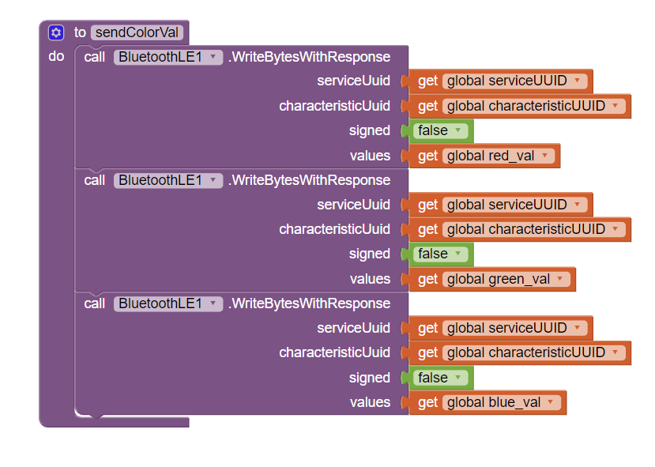

# Firmware

All sketches are in [`firmware/`](../firmware). Each sits in a folder with the same name, as the Arduino IDE expects.

| Sketch | Board | Purpose |
|---|---|---|
| `flight_controller_nano33ble` | Nano 33 BLE | Integrated loop: MPU6050 DMP → pitch/roll PID → mixer → PWM, plus battery monitor. Throttle comes from USB serial. |
| `flight_controller_nano_avr` | Classic Nano (ATmega328) | Earlier version of the same loop with a serial Bluetooth module on SoftwareSerial (D7/D8). Uses AVR-only registers. |
| `ble_gesture_control` | Nano 33 BLE | BLE peripheral with the custom GATT service. Values written from the phone switch the RGB LED. |
| `ble_peripheral_led` | Nano 33 BLE | BLE bring-up: advertise as `drone`, report the connected central's MAC, blink an LED on command. |
| `ble_advertise_test` | Nano 33 BLE | Minimal check that `BLE.begin()` succeeds. Blinks the RGB LED until it does, then advertises. |
| `ble_serial_echo` | Nano 33 BLE | Advertises and echoes serial bytes. |
| `pwm_motor_ramp` | Nano 33 BLE | Ramps a motor channel from 0→255 duty, holds, then stops. Used to test the MOSFET drivers. |

## Development timeline

1. **PWM bring-up** (`pwm_motor_ramp`): confirmed each MOSFET channel and motor responds to `analogWrite`.
2. **BLE bring-up** (`ble_advertise_test` → `ble_serial_echo` → `ble_peripheral_led`): got the radio advertising, then accepting a central connection.
3. **BLE control** (`ble_gesture_control`): custom service/characteristic driven from the phone app.
4. **Attitude + PID** (`flight_controller_nano_avr` → `flight_controller_nano33ble`): MPU6050 DMP, PID and mixer, first on a classic Nano with a serial BT module, then ported to the Nano 33 BLE.

## BLE control

BLE organises data in a **GATT** (Generic Attribute Profile) database: *profile → services → characteristics*. Each service and characteristic is identified by a UUID. 16-bit UUIDs are reserved for standard profiles, so custom ones use a random 128-bit UUID.

```cpp
const char* deviceServiceUuid              = "faa94135-6303-4274-a2ce-8fa28849ac9c";
const char* deviceServiceCharacteristicUuid = "a6671089-7187-4a45-adee-6020212f014d";

BLEService gestureService(deviceServiceUuid);
BLEByteCharacteristic gestureCharacteristic(deviceServiceCharacteristicUuid, BLERead | BLEWrite);
```

Start-up sequence:

1. `BLE.begin()`, then set the local name (`drone`) so it's easy to find in a scan.
2. Add the characteristic to the service and the service to the GATT database.
3. Write an initial value of `-1`, so the first real write from the phone is easy to spot.
4. `BLE.advertise()`: the peripheral broadcasts on the three advertising channels until a central connects.

In `loop()`, once `BLE.central()` returns a connected device, the sketch polls `gestureCharacteristic.written()` and dispatches the new value (`48` = up, `49` = down, `2` = left, `3` = right in the test sketch).

### Phone app (MIT App Inventor)

The Android app scans, connects, and calls `WriteBytesWithResponse` on the service/characteristic UUIDs above, with one slider per value.





## Attitude estimation

The MPU6050's on-chip **DMP** fuses gyro and accelerometer data and produces a quaternion. The sketch reads one DMP packet from the FIFO and derives yaw / pitch / roll:

```cpp
mpu.dmpGetQuaternion(&q, fifoBuffer);
mpu.dmpGetGravity(&gravity, &q);
mpu.dmpGetYawPitchRoll(ypr, &q, &gravity);
```

While throttle is 0, the current angles are stored as the level reference (`ypr_cal`), and later readings are taken relative to it.

## PID + motor mixing

Two independent PID loops (Brett Beauregard's `PID_v1`), one per axis:

```cpp
double consKp = 0.5, consKi = 0.05, consKd = 0.05;
pitchPID.SetOutputLimits(-20, 20);
rollPID.SetOutputLimits(-20, 20);
// setpoints = 0° (level)
```

The outputs go into an X-quad mixer:

```cpp
actSpeed[0] = throttle + roll - pitch;   // front-left  (D3)
actSpeed[1] = throttle + roll + pitch;   // front-right (D9)
actSpeed[2] = throttle - roll + pitch;   // back-right  (D10)
actSpeed[3] = throttle - roll - pitch;   // back-left   (D11)
// negative values clamped to 0
```


## Battery monitor

```cpp
#define ALPHA 0.1
motorBattery = (1 - ALPHA) * motorBattery + ALPHA * (analogRead(A0) / 1023.0 * MULTIPLIER);
if (motorBattery < 2.0) Serial.println(F("WARNING! LOW BATTERY!"));
```

An exponential moving average smooths out motor-induced ripple. `MULTIPLIER` should equal `V_ref × (R_top + R_bottom) / R_bottom` for the divider actually fitted (see [hardware.md §6](hardware.md#6-battery-voltage-sensing)). The value `6.67` in the sketch should be re-checked against the 33 k / 10 k divider and the reference voltage in use.

## Known limitations / next steps

* Apply the mixer output to the motors (`runIndividual(actSpeed)` is commented out) and merge the BLE command path into the flight loop.
* Fix the swapped `pitchPID`/`rollPID` names, then tune gains on a gimballed test rig.
* Remove the blocking "wait for serial character" step so the craft can boot on battery alone.
* Calibrate the MPU6050 offsets for this sensor (the `CalibrateGyro` routine from I2Cdevlib) instead of the example defaults.
* Add yaw control and use the VL53L0X ToF sensor for altitude hold.
