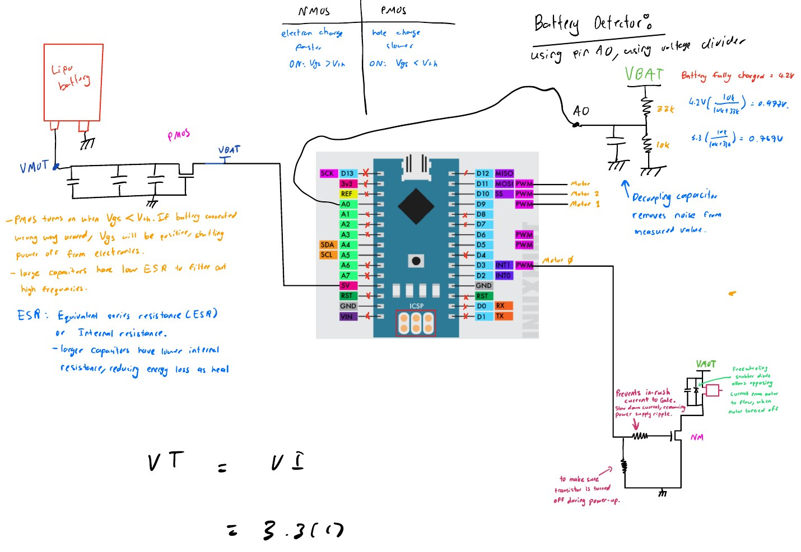
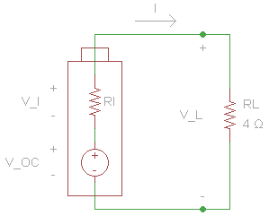

# Hardware design notes

These notes are compiled from the final report, the presentation, and the handwritten design notes ([PDF](reports/Design_Notes_handwritten.pdf)).



## 1. Frame

* Kept as small as possible, since less mass means less thrust is needed.
* Motor sockets sized for **8520** motors (8.5 mm can diameter × 20 mm length). A different motor size needs the sockets redesigned.
* Printed in Prusament PLA on an Original Prusa i3 MK3S at 0.07 mm "ULTRADETAIL" layers: ≈4 h 26 min, ≈12 g.
* The centre of mass should sit at the geometric centre; small trim weights can be added to balance it.

Files: [`hardware/frame`](../hardware/frame).

## 2. Motors

Brushed coreless DC motors were chosen over brushless because they are cheap, small, and need no ESCs. A single MOSFET per motor is enough. Selection criteria:

| Criterion | Notes |
|---|---|
| Type | Brushed DC: small, simple drive; less thrust than brushless, so only for nano-size craft |
| Can size | 8.5 mm × 20 mm to fit the frame |
| Static thrust | Must exceed total craft weight with margin |
| Weight | Adds directly to all-up weight |
| Load current | ≈2.75 A per motor with props at full throttle (drops sharply without props) |
| Lifetime | Expect ~5–6 h for cheap motors |

The downside of the 8520s used is that no datasheet was available.

## 3. Battery

Criteria: chemistry (LiPo / Li-ion / graphene), capacity (mAh), continuous and burst discharge rate (C), and weight.

**Sizing calculation**

```
Peak motor current      I = 4 × 2.75 A           ≈ 11 A
Chosen pack             C = 650 mAh = 0.65 Ah   (typical nano range: 150–350 mAh)
Required discharge rate     11 A / 0.65 Ah       ≈ 17 C
Full-throttle endurance     0.65 Ah × 60 / 11 A  ≈ 3.5 min
```

Rule of thumb for usable continuous current: `capacity × C-rating × 0.8` (20 % safety margin).

The electronics draw far less than the motors, so only the motor current matters for the C-rating.

## 4. Motor drivers (MOSFETs)

A GPIO pin can source only ~20 mA, so each motor is switched on its low side by an N-MOSFET. The motor's + lead goes to the battery rail, its – lead to the drain, and the source to ground. PWM on the gate sets the average motor voltage and therefore the speed.

What to look for:

* **I<sub>D(max)</sub> ≥ ~3 A** to cover the ≈2.75 A motor current.
* **Low V<sub>GS(th)</sub> (~1 V)** so the 3.3 V Nano 33 BLE output fully enhances the FET. Check the I<sub>D</sub> vs V<sub>GS</sub> curve, not just the threshold.
* **Low R<sub>DS(on)</sub>** (~0.03 Ω). At 3 A, 0.3 Ω would drop 0.9 V and starve the motor.

Supporting parts per channel (from the hand-drawn schematic):

* **Gate series resistor**: limits in-rush current into the gate capacitance and slows the edges slightly.
* **Gate pull-down resistor**: keeps the FET off while the MCU is booting and the pin is floating.
* **Freewheeling diode across the motor**: gives the inductive kick-back current a path when the FET turns off.

## 5. Reverse-polarity protection


A **P-MOSFET (AO3401A)** sits in the supply path between the battery (`VBAT`) and the motor/logic rail (`VMOT`):

* Battery inserted correctly: V<sub>GS</sub> is negative, the FET turns on, and the loss is only I·R<sub>DS(on)</sub>.
* Battery reversed: V<sub>GS</sub> is positive, the FET stays off, and the electronics are isolated.

This was chosen over a series diode because a diode's ~0.3–0.7 V drop at 11 A wastes a lot of power and headroom on a 1S pack.

Bulk capacitors (2 × 100 µF) on the rail supply the motors' current spikes. Larger capacitors have lower ESR (equivalent series resistance), so they waste less energy as heat and filter high-frequency noise better.

## 6. Battery voltage sensing



* A **33 kΩ / 10 kΩ** divider from `VBAT` to `A0`, with a decoupling capacitor at the ADC pin to remove noise.
* At a full 4.2 V: `4.2 × 10k / (10k + 33k) ≈ 0.977 V`, which stays under a 1.1 V internal reference.
* The ADC is 10-bit (0–1023 counts). Convert back with

  ```
  V_bat = ADC / 1023 × V_ref × (R_top + R_bottom) / R_bottom
        = ADC / 1023 × 1.1 V × 4.3
  ```

## 7. Voltage regulation (background notes)

The design notes compare regulator families for the logic supply:

| | Switching regulator | Linear regulator |
|---|---|---|
| Topologies | Step-down, step-up, inverting (isolated / non-isolated) | Step-down only (shunt, LDO) |
| Efficiency | High | Low when V<sub>in</sub> − V<sub>out</sub> is large |
| Output current | High | Small |
| Noise / ripple | Higher | Low, no ripple |
| External parts | Many (C<sub>in</sub>, C<sub>out</sub>, L, diode) | Few (C<sub>in</sub>, C<sub>out</sub>) |

## 8. What went wrong electrically

Under full motor load (~11 A) the LiPo's internal resistance dropped the rail to **≈1.8–1.9 V**, below the Nano 33 BLE's **≈2.6 V brown-out** threshold, so the MCU reset every time the motors spun up.


Possible fixes for a v2:

* A higher-C, lower-internal-resistance pack (or 2S with a buck regulator).
* A separate, regulated logic supply (boost converter or LDO from a dedicated cell) so motor sag can't reach the MCU.
* More low-ESR bulk capacitance close to the MCU and IMU.
* Ramp the motors up in software instead of stepping them.
