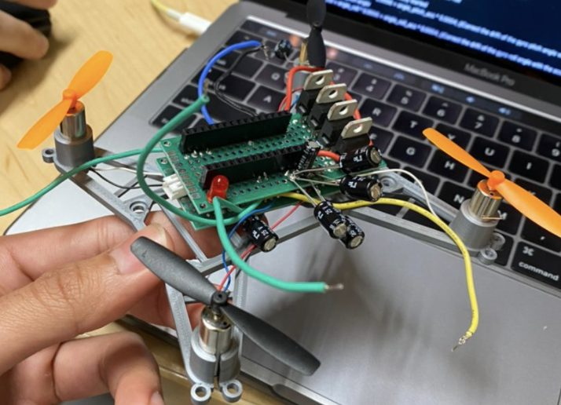

# Hardware

## Main components

| Part | Role |
|---|---|
| Arduino Nano 33 BLE | MCU + BLE radio, hardware PWM on any digital pin |
| MPU6050 | 6-axis IMU with on-chip DMP, I²C |
| VL53L0X | Time-of-flight distance sensor (bought for altitude hold; not integrated yet) |
| 4 × 8520 brushed DC motors + props | Propulsion |
| 4 × logic-level N-MOSFETs | Low-side motor switches |
| AO3401A P-MOSFET | Reverse-polarity protection |
| SS34 Schottky diode | Protection at the battery connector |
| 1S 650 mAh LiPo (4.2 V full) | Power |
| 2 × 100 µF + decoupling caps | Bulk / noise filtering |
| 33 kΩ + 10 kΩ | Battery voltage divider to A0 |

## Pin map (flight controller)

| Nano 33 BLE pin | Connection |
|---|---|
| D3 | Front-left motor MOSFET gate |
| D9 | Front-right motor MOSFET gate |
| D10 | Back-right motor MOSFET gate |
| D11 | Back-left motor MOSFET gate |
| A4 (SDA) / A5 (SCL) | MPU6050 I²C |
| A0 | Battery divider (33 k / 10 k) |
| 3.3 V / GND | MPU6050 power |

> The `pwm_motor_ramp` test sketch labels the same pins differently (D3 bottom-right, D9 bottom-left, D10 top-left, D11 top-right). Confirm motor positions against your own wiring.

## Frame files (`frame/`)

| File | Description |
|---|---|
| `frame_main_111x114mm.stl` | Main X-frame with 8.5 mm motor sockets |
| `mount_plate_32x86mm.stl` | Mounting plate |
| `clip_24x5mm.stl` | Small clip / retainer |
| `frame_main_prusaslicer.3mf` | PrusaSlicer project for the main frame |
| `frame_main_PrusaMK3S_PLA.gcode` | Ready-to-print G-code (Prusa i3 MK3S, PLA, 0.07 mm) |

## Schematics

* System block diagram: [`docs/images/block_diagram.png`](../docs/images/block_diagram.png)
* Reverse-polarity protection: [`docs/images/reverse_polarity_pmos.png`](../docs/images/reverse_polarity_pmos.png)
* Hand-drawn wiring / pin assignment: [`docs/images/wiring_notes_handwritten.jpg`](../docs/images/wiring_notes_handwritten.jpg)

Design rationale and calculations: [`docs/hardware.md`](../docs/hardware.md).
